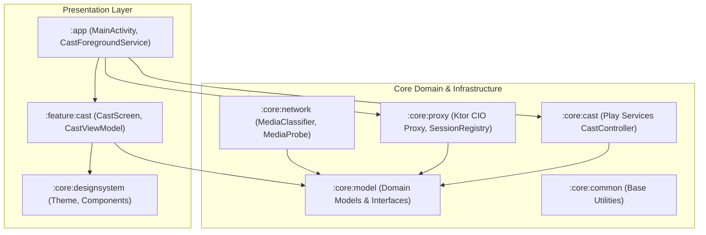

# AlwaysCast

Cast web video to a 1st Generation Chromecast (2013) from an Android phone, without external servers, accounts, or telemetry.

The 2013 Chromecast (model H2G2-42) still functions well as an HDMI endpoint. What it lost over time is the software bridge between modern web video delivery and the physical screen. Many modern video CDNs protect streaming assets with HTTP header checks (`Referer`, `Origin`, custom `User-Agent`) or CORS policies that the device's receiver cannot attach.

**AlwaysCast** solves this: you provide a video URL, the app inspects compatibility and serves the stream through an embedded HTTP proxy on your phone that injects all required headers, while casting to the Google Cast **Default Media Receiver** (`CC1AD845`).

---

## Architecture

The project is structured as a modular Clean Architecture system with strict unidirectional dependencies:



### Request & Streaming Flow

```
+---------------+              +----------------------------+              +-----------------+
|   Web Video   | <=== HTTP == |    Local Phone Proxy       | <=== HTTP == | 1st Gen         |
|   Provider    | (with inject)|  (Ktor CIO + OkHttp Engine)| (Range 206)  | Chromecast (DMR)|
|     (CDN)     |   headers)   |  :core:proxy on LAN IP:8080|              |    (CC1AD845)   |
+---------------+              +----------------------------+              +-----------------+
                                             ^
                                             | Play URL via Cast SDK
                                      +--------------+
                                      | AlwaysCast UI|
                                      | & ViewModel  |
                                      +--------------+
```

1. **Resolution & Classification**: The app verifies the media stream (`:core:network`), identifying codec and container compatibility.
2. **Session Registration**: Target origin URL and required headers (`Referer`, `User-Agent`) are stored in an in-memory session registry (`:core:proxy`).
3. **Foreground Service**: A foreground service (`mediaPlayback` type) keeps the proxy engine alive and holds a wake lock even when the screen is locked.
4. **Cast to DMR**: The Cast SDK instructs the Chromecast Default Media Receiver to load `http://<PHONE_LAN_IP>:<PORT>/s/<TOKEN>/media.ext`.
5. **Streaming with Range Support**: The Chromecast issues standard HTTP byte-range requests (`bytes=start-end` and `bytes=start-`), which the proxy streams directly from the CDN with `206 Partial Content`.

---

## Hardware Compatibility Matrix

Empirically verified in Phase 0 against physical 1st Gen Chromecast hardware (firmware `CrKey/1.36.157768`):

| Media Format / Codec | Target Container | Supported | Notes |
|----------------------|------------------|:---------:|-------|
| H.264 (AVC) + AAC | MP4 (faststart) | **Yes** | Optimal experience, instant start. |
| H.264 (AVC) + AAC | MP4 (moov at end) | **Yes** | Device reads index via byte-ranges at end of file before playback. |
| H.264 + AC3 (Dolby Digital) | MP4 | **Yes** | Digital audio passthrough. |
| VP8 + Vorbis | WebM | **Yes** | Fully supported in Chromium 70 receiver. |
| HLS (unencrypted) | `.m3u8` + TS | **Yes** | Native HLS parser in DMR. |
| HLS with AES-128 | `.m3u8` + TS + Key | **Yes** | Receiver fetches `enc.key` and decrypts in hardware. |
| H.264 + AAC | MKV (Matroska) | **Yes** | Receiver demuxes MKV natively (no remuxing required). |
| 1080p @ 12 Mbps (High Bitrate)| MP4 | **Yes** | Hardware decoder easily handles high bitrate without frame drops. |
| HEVC / H.265 | MP4 / MKV | **No** | Silicon limitation (no hardware decoder in Marvell SoC). |
| AV1 | MP4 / MKV | **No** | Silicon limitation. |

---

## What It Does Not Do

- **DRM**: Protected content requiring Widevine Modular or PlayReady CDM is not supported.
- **HEVC / AV1 / 4K**: The 2013 Chromecast SoC physically lacks hardware decoders for modern codecs beyond H.264 and VP8. The app surfaces explicit incompatibility notices (`Verdict.Unsupported`).
- **On-Device Transcoding**: Real-time video transcoding on a mobile phone causes severe thermal throttling and extreme battery drain without unmaintained native toolchains (see [ADR 0004](docs/adr/0004-sin-transcodificacion.md)).
- **`blob:` URLs / Complex MSE**: Streams created exclusively inside client-side JavaScript Media Source Extensions without accessible HTTP video endpoints cannot be extracted directly from a raw URL.

---

## Network & Google Home Setup Notes

> [!IMPORTANT]
> **2.4 GHz Wi-Fi & Dual-Band Routers**:
> The 1st Generation Chromecast only contains a 2.4 GHz 802.11b/g/n radio. It will never see or connect to a 5 GHz SSID.
>
> If your Android phone is connected to 5 GHz while the Chromecast is on 2.4 GHz:
> - Most modern home routers automatically bridge 2.4 GHz and 5 GHz traffic on the same subnet, allowing mDNS discovery and local HTTP streaming to work seamlessly.
> - Ensure **AP Isolation** (Client Isolation) is **disabled** in your router settings.
> - If your router separates bands into isolated VLANs or subnets, connect your phone to the 2.4 GHz band.

> [!NOTE]
> **Google Home App Generations**:
> In recent releases of the Google Home application, setup of vintage 1st generation Chromecasts can occasionally fail or hide the device during initial network pairing. If you factory-reset a 1st Gen Chromecast, complete the initial Wi-Fi configuration using an older version of Google Home or a 2.4 GHz-only connection. Once configured on your Wi-Fi, AlwaysCast discovers and communicates with it directly via standard mDNS and Google Cast SDK v3.

---

## Test Media Harness

The repository includes the complete standalone testing harness used to validate the media envelope:

- **`tools/testmedia/gen-testmedia.ps1`**: PowerShell script to generate all 9 test matrix samples via `ffmpeg`.
- **`tools/testmedia/server.js`**: Lightweight Node.js server with RFC 7233 byte-range serving and detailed request logging.
- **`tools/testmedia/sender.html`**: Web-based Cast sender to test playback on the TV from Google Chrome.

See [tools/testmedia/README.md](tools/testmedia/README.md) for full instructions.

---

## Architectural Decision Records (ADRs)

Key architectural decisions are documented in `docs/adr/`:
- [ADR 0001: Módulos y capas](docs/adr/0001-modulos-y-capas.md)
- [ADR 0002: Elección de receptor Cast y API de envío](docs/adr/0002-cast-receiver-y-api.md)
- [ADR 0003: Servidor proxy HTTP local en el teléfono](docs/adr/0003-proxy-en-el-telefono.md)
- [ADR 0004: Decisión de no transcodificar medios en el teléfono](docs/adr/0004-sin-transcodificacion.md)

---

## Building and Verification

Prerequisites:
- Android Studio Ladybug / Meerkat or Android SDK with platform 35 and build-tools 35.0.0.
- JDK 17 or JDK 21.

```bash
# Check code style with Ktlint
./gradlew ktlintCheck

# Run Detekt static analysis
./gradlew detekt

# Run all unit tests
./gradlew testDebugUnitTest

# Assemble debug APK
./gradlew assembleDebug
```

---

## License

This project is licensed under the [Apache-2.0 License](LICENSE).
